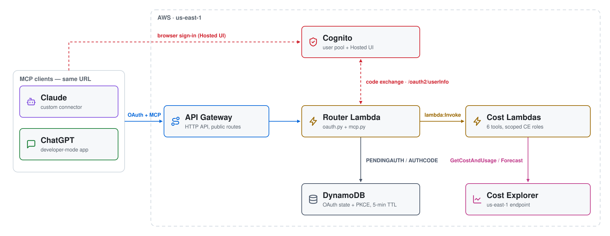
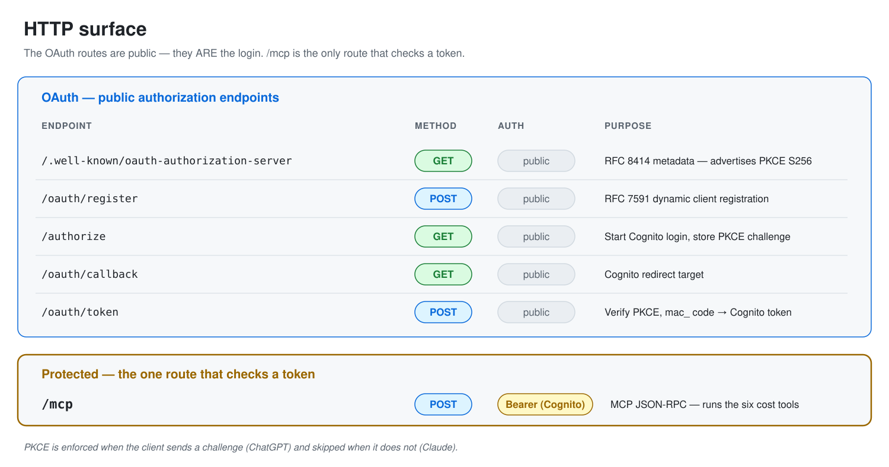

# AWS Cognito MCP — Cost Explorer Connector

This project delivers a **remote MCP (Model Context Protocol) connector** on AWS
that lets **Claude** or **ChatGPT** query AWS costs in plain English — secured
with **Amazon Cognito OAuth 2.0**. Either client connects **directly** to the
same remote `https://…/mcp` endpoint, signs the user in through Cognito's Hosted
UI, and calls the cost tools.

**There is no local proxy, no SigV4 signing, and no API keys to distribute.**

It uses **Terraform** and **Python (boto3)** to provision and deploy the backend.
The only thing a user does is paste one URL into their MCP client.

> This is the Cognito port of [`aws-serverless-mcp`](https://github.com/mamonaco1973/aws-serverless-mcp),
> which secured the API with AWS IAM and required a local SigV4-signing proxy
> script. The OAuth authorization-server proxy pattern is the key enabler for
> going proxy-free.

<picture>
  <source media="(prefers-color-scheme: dark)" srcset="architecture-dark.svg">
  
</picture>

Regenerate the diagrams with `python make_diagram.py`.

## How it works

An **API Gateway HTTP API** fronts a single **router Lambda**. Every route is
public at the gateway — authentication is enforced inside the Lambda. Claude and
ChatGPT walk the same five steps:

1. **Discovery** — the client fetches `GET /.well-known/oauth-authorization-server`
   and learns this API is its OAuth authorization server.
2. **Registration** — the client self-registers via `POST /oauth/register`
   (RFC 7591) and receives the shared MCP `client_id`.
3. **Login** — the client opens `GET /authorize`; the Lambda redirects the
   browser to Cognito's Hosted UI. After the user signs in, Cognito calls back to
   `GET /oauth/callback`.
4. **Token** — the client exchanges a one-time code at `POST /oauth/token` for a
   real Cognito access token.
5. **Use** — the client calls `POST /mcp` with `Authorization: Bearer <token>`.
   The Lambda validates the token via Cognito's `/oauth2/userInfo` endpoint,
   then invokes the appropriate cost Lambda.

### Why an OAuth proxy?

Both clients use a `redirect_uri` that Cognito cannot know in advance — claude.ai's
embeds your org ID, and ChatGPT's is per app. Cognito only accepts exact,
pre-registered callback URLs. `oauth.py` solves this by advertising **our API**
as the authorization server, registering only our fixed `/oauth/callback` with
Cognito, and brokering the flow — handing the client a genuine Cognito access
token without Cognito ever seeing the client's URL.

### PKCE — what ChatGPT needs

ChatGPT refuses to create a connector unless the authorization-server metadata
advertises PKCE (RFC 7636):

```json
"code_challenge_methods_supported": ["S256"]
```

Without it, ChatGPT fails with *"Some app settings were rejected. Check the
server URL or tunnel ID, icon, and authentication settings"* — which reads like
a URL problem but is not.

With it, ChatGPT sends a `code_challenge` to `/authorize` and the matching
`code_verifier` to `/oauth/token`. `oauth.py` carries the challenge through
DynamoDB alongside the one-time `mac_` code and only releases the Cognito token
if `SHA-256(verifier)` matches. Only `S256` is accepted.

Claude does not send a challenge today, so PKCE is enforced **only when the
client starts it**. Making it mandatory would break the Claude connector.

Key capabilities demonstrated:

1. **Remote MCP over OAuth** — Claude and ChatGPT connect to the same remote
   endpoint natively; no local runtime on the caller's machine.
2. **Cognito-secured** — every `/mcp` call carries a validated Cognito access
   token tied to a real user account.
3. **Authorization-server proxy** — `oauth.py` implements RFC 8414 metadata, RFC
   7591 dynamic registration, RFC 7636 PKCE, and the full
   authorize→callback→token flow.
4. **Least-privilege fan-out** — the router holds only `lambda:InvokeFunction` on
   the seven cost Lambdas; each cost Lambda keeps its own scoped Cost Explorer
   role.
5. **Infrastructure as Code** — Terraform provisions Lambdas, Cognito, DynamoDB,
   IAM, and API Gateway in a single apply.

## Prerequisites

* [An AWS Account](https://aws.amazon.com/console/) with Cost Explorer enabled
  (Billing console → Cost Explorer → Enable)
* [AWS CLI](https://docs.aws.amazon.com/cli/latest/userguide/getting-started-install.html)
* [Terraform](https://developer.hashicorp.com/terraform/install)
* `jq` in PATH (used by `apply.sh` / `validate.sh`)
* An MCP client that supports remote connectors with OAuth:
  * **Claude** — claude.ai custom connectors, or Claude Desktop
  * **ChatGPT** — a plan with developer mode (Plus, Pro, Business, Enterprise
    or Edu)

## Download

```bash
git clone https://github.com/mamonaco1973/aws-cognito-mcp.git
cd aws-cognito-mcp
```

## Deploy

```bash
# Optional: seed a ready-to-use login (otherwise create a user manually, below)
export TF_VAR_test_user_email="you@example.com"
export TF_VAR_test_user_password="ChangeMe-Str0ng!"

./apply.sh
```

`apply.sh`:
1. `check_env.sh` — validates tools and AWS credentials.
2. `terraform apply` in `01-lambdas/` — deploys the six cost Lambdas, the router
   Lambda, Cognito (user pool + Hosted UI + MCP client), the OAuth state table,
   and the HTTP API.
3. `validate.sh` — direct-invokes each cost Lambda to confirm Cost Explorer
   connectivity, then prints the **MCP endpoint**:

```
========================================================================
  Validation complete — tool registry + all six MCP cost tools OK.
========================================================================
  MCP endpoint: https://<api-id>.execute-api.us-east-1.amazonaws.com/mcp
========================================================================
```

That one URL is all either client needs. Get it again any time with:

```bash
(cd 01-lambdas && terraform output -raw mcp_endpoint)
```

### Connect Claude

1. In claude.ai: **Settings → Connectors → Add custom connector**.
2. Give it a name and paste the MCP endpoint URL. Leave the advanced OAuth
   client ID / secret fields empty — Claude registers itself.
3. Click **Add**, then **Connect**. Claude opens the Cognito Hosted UI in your
   browser. New users click **Sign up** to self-register (email verification),
   then sign in — the six cost tools appear.

### Connect ChatGPT

1. In ChatGPT: **Settings → Apps & Connectors → Advanced settings** and turn on
   **Developer mode**.
2. Back in **Apps & Connectors**, click **Create**.
3. Fill in the form:
   * **Name** — e.g. `AWS Costs`
   * **MCP Server URL** — the MCP endpoint URL
   * **Authentication** — **OAuth** (leave client ID / secret empty; ChatGPT
     registers itself)
   * Tick **I trust this application**
4. Click **Create**. ChatGPT opens the Cognito Hosted UI — sign in (or **Sign
   up**) and the six cost tools are listed on the app.
5. In a new chat, pick the app from the **+** menu (Developer mode) and ask
   about your AWS costs.

> Use the same Cognito account in both clients and you are the same user to the
> backend — the cost tools return the same account data either way.

> **Self-signup is open by default.** Anyone who can reach the connector URL can
> register and read your AWS cost data. Keep the endpoint private, or lock it
> down: add a Cognito **pre-sign-up Lambda trigger** to allowlist email domains,
> or set `allow_admin_create_user_only = true` in `cognito.tf` for admin-only
> provisioning.

### Pre-create a user (instead of self-signup)

```bash
POOL=$(cd 01-lambdas && terraform output -raw cognito_user_pool_id)

aws cognito-idp admin-create-user \
  --user-pool-id "$POOL" \
  --username you@example.com \
  --user-attributes Name=email,Value=you@example.com Name=email_verified,Value=true

aws cognito-idp admin-set-user-password \
  --user-pool-id "$POOL" \
  --username you@example.com \
  --password 'YourPassw0rd!' --permanent
```

## Teardown

```bash
./destroy.sh
```

---

## MCP Tools

All six tools take no input and return plain-text summaries suitable for direct
narration.

| Tool | Backing Lambda | Description |
|------|----------------|-------------|
| `get_month_to_date_cost` | `cost-mtd` | Total AWS spend from the 1st of this month through today |
| `get_cost_by_service` | `cost-by-service` | MTD spend broken down by service, sorted descending |
| `compare_this_month_to_last_month` | `cost-compare` | This month MTD vs last month full total |
| `get_daily_cost_trend` | `cost-daily` | Day-by-day spend for the current month with running totals |
| `find_top_cost_drivers` | `cost-top-drivers` | Top 10 services by spend with percentage share |
| `forecast_month_end_cost` | `cost-forecast` | Projected remaining spend through end of month (80% CI) |

`tools/list` is served from `TOOL_REGISTRY` in `costs.py` (the single source of
truth), fetched by the router from the `cost-tools` Lambda.

### Example responses

**`get_month_to_date_cost`**
```
Month-to-date AWS cost (2026-04-01 through 2026-04-27): $142.38 USD
```

**`find_top_cost_drivers`**
```
Top AWS cost drivers (2026-04-01 through 2026-04-27):
   1. Amazon EC2: $87.14 (61.2% of total)
   2. Amazon RDS: $31.20 (21.9% of total)
   ...
  Total across all services: $142.38
```

---

## HTTP surface

<picture>
  <source media="(prefers-color-scheme: dark)" srcset="http-surface-dark.svg">
  
</picture>

| Endpoint | Method | Auth | Purpose |
|----------|--------|------|---------|
| `/.well-known/oauth-authorization-server` | GET | public | RFC 8414 metadata (advertises PKCE `S256`) |
| `/oauth/register` | POST | public | RFC 7591 dynamic registration |
| `/authorize` | GET | public | Start Cognito login; store the PKCE challenge |
| `/oauth/callback` | GET | public | Cognito redirect target |
| `/oauth/token` | POST | public | Verify PKCE; exchange code → Cognito access token |
| `/mcp` | POST | **Bearer (Cognito)** | MCP JSON-RPC |

The OAuth endpoints are public because they *are* the authentication; `/mcp`
validates the Bearer token inside the Lambda.
